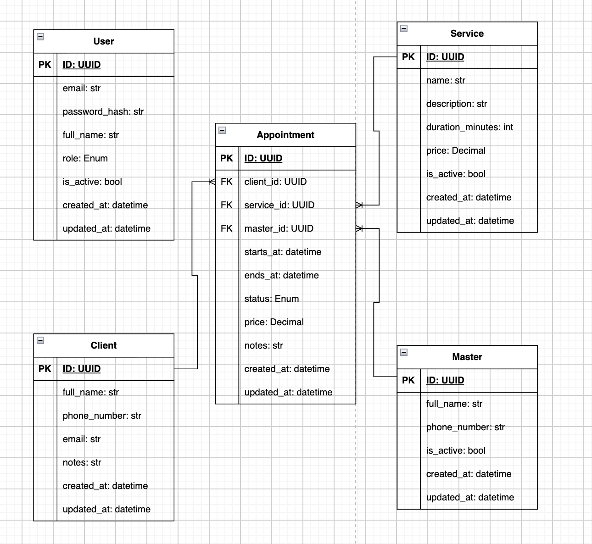

# Salon CRM

----------------------
Backend API CRM-системы для управления работой салона красоты. Проект предназначен для хранения информации о клиентах, мастерах и услугах, а также для создания и управления записями на процедуры.


**Основной акцент проекта** — корректная работа с расписанием мастеров и предотвращение конфликтующих бронирований на уровне базы данных.

----------------------

### Возможности

* Управление клиентами салона.

* Управление мастерами.

* Управление услугами и их стоимостью.

* Создание записей с автоматическим расчётом времени окончания процедуры.

* Проверка существования клиента, мастера и услуги при создании записи.

* Защита от пересечения активных записей одного мастера.

* Миграции схемы базы данных с помощью Alembic.

* Автоматизированные тесты API.
----------------------
### Технологический стек

***Python*** — основной язык разработки.

***FastAPI*** — создание REST API.

***SQLModel*** — модели данных и взаимодействие с базой данных.

***PostgreSQL*** — реляционная база данных.

***SQLAlchemy*** — управление сессиями и транзакциями.

***Alembic*** — миграции базы данных.

***Docker Compose*** — запуск инфраструктуры в контейнерах.

***pytest, HTTPX*** — тестирование API.

----------------------

### Запуск проекта

**Требования**

* Python 3.13+.

* Docker и Docker Compose.


**Клонирование репозитория**
```
git clone git@github.com:whopid/salon_crm.git
cd salon_crm
```

**Настройка переменных окружения**

Создайте файл .env в корне проекта и укажите параметры подключения к PostgreSQL. Названия переменных должны соответствовать используемым в проекте настройкам.

**Запуск PostgreSQL**
```
docker compose up -d
```


**Установка зависимостей**

Активируйте виртуальное окружение и установите зависимости проекта.
```
pip install -r requirements.txt
```


**Применение миграций**

Из корня проекта выполните:
```
alembic upgrade head
```


**Запуск API**
```
uvicorn app.main:app
```


Документация Swagger UI: http://127.0.0.1:8000/docs

-------------------------
### Примеры запросов

**Получение списка услуг**
```
curl http://127.0.0.1:8000/services
```

**Создание записи**
```
curl -X POST http://127.0.0.1:8000/appointments \
  -H "Content-Type: application/json" \
  -d '{
    "client_id": "UUID_КЛИЕНТА",
    "master_id": "UUID_МАСТЕРА",
    "service_id": "UUID_УСЛУГИ",
    "starts_at": "2026-11-10T10:00:00+00:00"
  }'
```

При успешном создании API возвращает 201 Created и данные записи, включая рассчитанное время окончания процедуры.

**Обработка конфликтующего бронирования**

Если у выбранного мастера уже есть активная запись на пересекающийся интервал:
```
curl -X POST http://127.0.0.1:8000/appointments \
  -H "Content-Type: application/json" \
  -d '{
    "client_id": "UUID_КЛИЕНТА",
    "master_id": "UUID_МАСТЕРА",
    "service_id": "UUID_УСЛУГИ",
    "starts_at": "2026-11-10T10:30:00+00:00"
  }'
```

При конфликте API возвращает 409 Conflict.

-------------------
### Ключевые решения

#### Защита от пересечения записей на уровне PostgreSQL

Для предотвращения пересечения записей одного мастера используется ограничение PostgreSQL EXCLUDE с индексом GiST и диапазонами времени tstzrange.


Логика ограничения:
```
EXCLUDE USING gist (
    master_id WITH =,
    tstzrange(starts_at, ends_at, '[)') WITH &&
)
WHERE (status IN ('scheduled', 'confirmed'))
```

Ограничение не позволяет сохранить две записи одного мастера, если их временные интервалы пересекаются и обе записи имеют активный статус.


Используется диапазон [): начало включается, конец не включается. Поэтому записи с 10:00 до 11:00 и с 11:00 до 12:00 допустимы — они не пересекаются.


Отменённые и завершённые записи не участвуют в проверке ограничения.


**Почему выбрано такое решение?**


Проверка пересечений только в Python недостаточна: два параллельных запроса могут одновременно проверить свободный интервал и оба попытаться создать запись. Ограничение PostgreSQL обеспечивает целостность данных даже при конкурентных запросах и не позволяет сохранить конфликтующие записи.

#### Транзакции и обработка ошибок

Создание записи выполняется с использованием сессии SQLAlchemy и транзакции базы данных. Изменения фиксируются через commit(). Если при сохранении возникает ошибка ограничения целостности, выполняется rollback(), а клиент получает ответ 409 Conflict.


Таким образом, база данных остаётся источником истины при проверке конкурентных бронирований. Предварительные проверки в API нужны для понятных ошибок, например 404 Not Found, если клиент, мастер или услуга не существуют, но они не заменяют ограничения базы данных.

#### Расчёт времени окончания процедуры

Время окончания (ends_at) рассчитывается автоматически на основе времени начала и длительности выбранной услуги:
```
ends_at = starts_at + timedelta(
    minutes=service.duration_minutes
)
```

Это позволяет не передавать длительность процедуры от клиента и использовать значение, сохранённое в базе данных.

#### Миграции схемы базы данных

Для управления изменениями схемы используется Alembic. Миграции позволяют воспроизводимо создавать и обновлять структуру базы данных, отслеживать изменения и разворачивать проект в другом окружении без ручного создания таблиц.

---------------
### Структура базы данных


**Основные сущности проекта:**


**_User_** — учётные записи пользователей системы и роли доступа.

**_Client_** — клиенты салона.

**_Master_** — мастера, выполняющие процедуры.

**_Service_** — услуги, их стоимость и длительность.

**_Appointment_** — записи клиентов к мастерам на услуги.


Связи между сущностями реализованы с помощью внешних ключей. Запись содержит ссылки на клиента, мастера и услугу.

-------------
### ER-диаграмма



--------------
### Тестирование

Для запуска тестов выполните:
```
python -m pytest -v
```


Тесты должны использовать отдельную тестовую базу данных, чтобы не изменять данные основной базы. Перед запуском тестов необходимо настроить TEST_DATABASE_URL и применить миграции к тестовой базе.


**Основные сценарии тестирования:**


* Успешное создание записи и корректный расчёт ends_at.

* Отклонение повторной записи на тот же интервал.

* Отклонение частично пересекающихся записей одного мастера.

* Успешное создание записи после отмены другой записи, использующей то же время.

* Корректная обработка ошибок целостности базы данных.

-------------
### Планы по развитию

- [ ] Добавить получение, обновление и удаление записей.

- [ ] Добавить аутентификацию и разграничение доступа по ролям.

- [ ] Реализовать поиск свободных интервалов мастеров.

- [ ] Расширить тестовое покрытие и автоматизировать проверку проекта в CI.